<p align="center">
  <picture>
    <source media="(prefers-color-scheme: dark)" srcset="https://raw.githubusercontent.com/tapedb/.github/main/profile/assets/banner-dark.svg">
    <source media="(prefers-color-scheme: light)" srcset="https://raw.githubusercontent.com/tapedb/.github/main/profile/assets/banner-light.svg">
    
  </picture>
</p>

<p align="center">
  A typed database for the apps you want to build. Live queries, offline writes, and a history you can replay. All in your own Cloudflare account.
</p>

<p align="center">
  <sub>TYPESCRIPT FIRST &nbsp;·&nbsp; ZERO CORE RUNTIME DEPENDENCIES &nbsp;·&nbsp; YOUR INFRASTRUCTURE</sub>
</p>

<p align="center">
  <a href="https://tapedb.dev">Website</a> &nbsp;·&nbsp;
  <a href="https://tapedb.dev/docs/">Documentation</a> &nbsp;·&nbsp;
  <a href="https://github.com/tapedb/tapedb">Source</a> &nbsp;·&nbsp;
  <a href="https://www.npmjs.com/package/@tapedb/tapedb">npm</a>
</p>

<br>

**TapeDB** is a TypeScript database library for Cloudflare. It combines schema-defined models and typed queries with live subscriptions and an offline write outbox. Each workspace has its own SQLite database inside a Durable Object.

<p align="center">
  <picture>
    <source media="(prefers-color-scheme: dark)" srcset="https://raw.githubusercontent.com/tapedb/.github/main/profile/assets/features-dark.svg">
    <source media="(prefers-color-scheme: light)" srcset="https://raw.githubusercontent.com/tapedb/.github/main/profile/assets/features-light.svg">
    
  </picture>
</p>

| Live, by subscription. | Offline isn't the end. | A history to build on. |
| :--- | :--- | :--- |
| Subscribe to a query and receive row-level updates when relevant data changes. The same API for a read or a live view. | Writes apply optimistically and queue in a persistent outbox. Reconnect and pick up where you left off. | Transactions go onto a log. Segments and snapshots reach R2, ready for replay and recovery when needed. |

<p align="center">
  <picture>
    <source media="(prefers-color-scheme: dark)" srcset="https://raw.githubusercontent.com/tapedb/.github/main/profile/assets/divider-a-dark.svg">
    <source media="(prefers-color-scheme: light)" srcset="https://raw.githubusercontent.com/tapedb/.github/main/profile/assets/divider-a-light.svg">
    
  </picture>
</p>

<sub>01 / LIVE</sub>

## A query. A live view. The same API.

Define a schema. Connect a client. Build the experience. TapeDB handles the space between your interface and your database.

<p align="center">
  <picture>
    <source media="(prefers-color-scheme: dark)" srcset="https://raw.githubusercontent.com/tapedb/.github/main/profile/assets/demo-dark.svg">
    <source media="(prefers-color-scheme: light)" srcset="https://raw.githubusercontent.com/tapedb/.github/main/profile/assets/demo-light.svg">
    
  </picture>
</p>

<sub>app.ts</sub>

```ts
// A query. A live view. The same API.
db.task.findMany({
  where: { done: false },
}).subscribe(({ data }) => render(data));

// One write reaches every subscriber.
await db.task.create({
  data: { title: "Replay the log" },
});
```

<sub>Typed end to end. No query strings.</sub>

<p align="center">
  <picture>
    <source media="(prefers-color-scheme: dark)" srcset="https://raw.githubusercontent.com/tapedb/.github/main/profile/assets/divider-b-dark.svg">
    <source media="(prefers-color-scheme: light)" srcset="https://raw.githubusercontent.com/tapedb/.github/main/profile/assets/divider-b-light.svg">
    
  </picture>
</p>

<sub>02 / SCHEMA</sub>

## Start with a model. Stay in your flow.

Fields, relations, and access rules in TypeScript. Your schema shapes the engine, migrations, and client types. TypeScript checks relation targets, inverses and personal-field subjects in your editor.

<sub>tapedb.schema.ts</sub>

```ts
import { schema, model, t } from "@tapedb/tapedb/schema";

export default schema({
  project: model({
    name: t.string(),
    tasks: t.hasMany("task"),
  }),
  task: model({
    title: t.string(),
    done: t.boolean().default(false),
    project: t.belongsTo("project"),
  }),
});
```

`01` &nbsp; **One definition.** Models drive your data layer.<br>
`02` &nbsp; **Real relations.** Link and query your models.<br>
`03` &nbsp; **Reviewed migrations.** SQL you can commit.

<sub>Your schema. Your source of truth.</sub>

<p align="center">
  <picture>
    <source media="(prefers-color-scheme: dark)" srcset="https://raw.githubusercontent.com/tapedb/.github/main/profile/assets/divider-a-dark.svg">
    <source media="(prefers-color-scheme: light)" srcset="https://raw.githubusercontent.com/tapedb/.github/main/profile/assets/divider-a-light.svg">
    
  </picture>
</p>

<sub>03 / ARCHITECTURE</sub>

## A workspace. A writer. A tape.

Each workspace has one Durable Object and one SQLite database. A single writer makes transactions serializable. R2 gives the log somewhere to go.

<p align="center">
  <picture>
    <source media="(prefers-color-scheme: dark)" srcset="https://raw.githubusercontent.com/tapedb/.github/main/profile/assets/architecture-dark.svg">
    <source media="(prefers-color-scheme: light)" srcset="https://raw.githubusercontent.com/tapedb/.github/main/profile/assets/architecture-light.svg">
    
  </picture>
</p>

> [!NOTE]
> **Your infrastructure.** Your application supplies identity; TapeDB manages workspace data.

## Built on

Built on primitives you already trust.

**Cloudflare Workers** &nbsp;·&nbsp; **Durable Objects** &nbsp;·&nbsp; **SQLite** &nbsp;·&nbsp; **R2** object storage

<p align="center">
  <picture>
    <source media="(prefers-color-scheme: dark)" srcset="https://raw.githubusercontent.com/tapedb/.github/main/profile/assets/divider-b-dark.svg">
    <source media="(prefers-color-scheme: light)" srcset="https://raw.githubusercontent.com/tapedb/.github/main/profile/assets/divider-b-light.svg">
    
  </picture>
</p>

## Get started

```bash
npx tapedb-cli@latest init
```

The interactive setup installs dependencies and lets you run locally or deploy to Cloudflare. [Follow the setup guide](https://tapedb.dev/docs/setup/).

## Studio

Browse and edit rows, run model queries, import and export CSV or JSON, inspect access rules and read workspace history.

[](https://tapedb.dev/docs/studio/)

[Explore Studio](https://tapedb.dev/docs/studio/) for the full guide and screenshots.

## Documentation

| Guide | What you'll find |
| :--- | :--- |
| [Introduction](https://tapedb.dev/docs/) | Overview and core concepts |
| [Setup](https://tapedb.dev/docs/setup/) | Interactive setup, local development and deployment |
| [Models](https://tapedb.dev/docs/models/) | Fields, relations and schema checks |
| [Queries & live data](https://tapedb.dev/docs/queries/) | Read and subscribe |
| [Writes & offline](https://tapedb.dev/docs/writes/) | Transactions and offline writes |
| [Studio](https://tapedb.dev/docs/studio/) | Data browser, query console, access and history |
| [Architecture](https://tapedb.dev/docs/architecture/) | Workspaces, storage and recovery |
| [Access](https://tapedb.dev/docs/access/) | Identity, roles and rules |
| [Migrations](https://tapedb.dev/docs/migrations/) | Review and apply schema changes |
| [Privacy](https://tapedb.dev/docs/privacy/) | Retention and personal data |
| [Export & erasure](https://tapedb.dev/docs/export/) | Export and erase workspace data |
| [API reference](https://tapedb.dev/docs/api/) | Package exports and types |
| [Limits](https://tapedb.dev/docs/limits/) | Supported limits |
