<p align="center">
  <picture>
    <source media="(prefers-color-scheme: dark)" srcset="https://raw.githubusercontent.com/tapedb/.github/main/profile/assets/banner-dark.svg">
    <source media="(prefers-color-scheme: light)" srcset="https://raw.githubusercontent.com/tapedb/.github/main/profile/assets/banner-light.svg">
    
  </picture>
</p>

<p align="center">
  A typed database for the apps you want to build. Live queries, offline writes, and a history you can replay. All in your own Cloudflare account.
</p>

<p align="center">
  <sub>TYPESCRIPT FIRST &nbsp;·&nbsp; ZERO CORE RUNTIME DEPENDENCIES &nbsp;·&nbsp; YOUR INFRASTRUCTURE</sub>
</p>

<br>

**TapeDB** is a TypeScript database library for Cloudflare. It combines schema-defined models and typed queries with live subscriptions and an offline write outbox. Each workspace has its own SQLite database inside a Durable Object.

> [!WARNING]
> **Development preview.** The repository is private and public package availability has not been announced. Examples describe the current API; installation instructions will be published with the release. The API may change before 1.0.

<p align="center">
  <picture>
    <source media="(prefers-color-scheme: dark)" srcset="https://raw.githubusercontent.com/tapedb/.github/main/profile/assets/features-dark.svg">
    <source media="(prefers-color-scheme: light)" srcset="https://raw.githubusercontent.com/tapedb/.github/main/profile/assets/features-light.svg">
    
  </picture>
</p>

| Live, by subscription. | Offline isn't the end. | A history to build on. |
| :--- | :--- | :--- |
| Subscribe to a query and receive row-level updates when relevant data changes. The same API for a read or a live view. | Single-row writes apply optimistically and queue in a persistent outbox. Reconnect and pick up where you left off. | Transactions go onto a log. Segments and snapshots reach R2, ready for replay and recovery when needed. |

<p align="center">
  <picture>
    <source media="(prefers-color-scheme: dark)" srcset="https://raw.githubusercontent.com/tapedb/.github/main/profile/assets/divider-a-dark.svg">
    <source media="(prefers-color-scheme: light)" srcset="https://raw.githubusercontent.com/tapedb/.github/main/profile/assets/divider-a-light.svg">
    
  </picture>
</p>

<sub>01 / LIVE</sub>

## A query. A live view. The same API.

Define a schema. Connect a client. Build the experience. TapeDB handles the space between your interface and your database.

<p align="center">
  <picture>
    <source media="(prefers-color-scheme: dark)" srcset="https://raw.githubusercontent.com/tapedb/.github/main/profile/assets/demo-dark.svg">
    <source media="(prefers-color-scheme: light)" srcset="https://raw.githubusercontent.com/tapedb/.github/main/profile/assets/demo-light.svg">
    
  </picture>
</p>

<sub>app.ts</sub>

```ts
// A query. A live view. The same API.
db.task.findMany({
  where: { done: false },
}).subscribe(({ data }) => render(data));

// One write reaches every subscriber.
await db.task.create({
  data: { title: "Replay the log" },
});
```

<sub>Typed end to end. No query strings.</sub>

<p align="center">
  <picture>
    <source media="(prefers-color-scheme: dark)" srcset="https://raw.githubusercontent.com/tapedb/.github/main/profile/assets/divider-b-dark.svg">
    <source media="(prefers-color-scheme: light)" srcset="https://raw.githubusercontent.com/tapedb/.github/main/profile/assets/divider-b-light.svg">
    
  </picture>
</p>

<sub>02 / SCHEMA</sub>

## Start with a model. Stay in your flow.

Fields, relations, and access rules in TypeScript. Your schema shapes the engine, migrations, and client types.

<sub>tapedb.schema.ts</sub>

```ts
import { schema, model, t } from "tapedb/schema";

export default schema({
  project: model({
    name: t.string(),
    tasks: t.hasMany("task"),
  }),
  task: model({
    title: t.string(),
    done: t.boolean().default(false),
    project: t.belongsTo("project"),
  }),
});
```

`01` &nbsp; **One definition.** Models drive your data layer.<br>
`02` &nbsp; **Real relations.** Link and query your models.<br>
`03` &nbsp; **Reviewed migrations.** SQL you can commit.

<sub>Your schema. Your source of truth.</sub>

<p align="center">
  <picture>
    <source media="(prefers-color-scheme: dark)" srcset="https://raw.githubusercontent.com/tapedb/.github/main/profile/assets/divider-a-dark.svg">
    <source media="(prefers-color-scheme: light)" srcset="https://raw.githubusercontent.com/tapedb/.github/main/profile/assets/divider-a-light.svg">
    
  </picture>
</p>

<sub>03 / ARCHITECTURE</sub>

## A workspace. A writer. A tape.

Each workspace has one Durable Object and one SQLite database. A single writer makes transactions serializable. R2 gives the log somewhere to go.

<p align="center">
  <picture>
    <source media="(prefers-color-scheme: dark)" srcset="https://raw.githubusercontent.com/tapedb/.github/main/profile/assets/architecture-dark.svg">
    <source media="(prefers-color-scheme: light)" srcset="https://raw.githubusercontent.com/tapedb/.github/main/profile/assets/architecture-light.svg">
    
  </picture>
</p>

> [!NOTE]
> **Your infrastructure.** Your application supplies identity; TapeDB manages workspace data.

## Built on

Built on primitives you already trust.

**Cloudflare Workers** &nbsp;·&nbsp; **Durable Objects** &nbsp;·&nbsp; **SQLite** &nbsp;·&nbsp; **R2** object storage

<p align="center">
  <picture>
    <source media="(prefers-color-scheme: dark)" srcset="https://raw.githubusercontent.com/tapedb/.github/main/profile/assets/divider-b-dark.svg">
    <source media="(prefers-color-scheme: light)" srcset="https://raw.githubusercontent.com/tapedb/.github/main/profile/assets/divider-b-light.svg">
    
  </picture>
</p>

## Documentation

| Section | |
| :--- | :--- |
| Introduction | Overview |
| Models | Define your models |
| Queries & live data | Read and subscribe |
| Writes & offline | Write while offline |
| Architecture | Understand recovery |
| Access & migrations | |
| Limits & status | Review limits and release status |

## Status

TapeDB is in development. We're validating the complete path from the installed package to a running database, before opening the source and announcing availability.

<sub>Pre-1.0. The API may change. Public release not yet announced.</sub>
